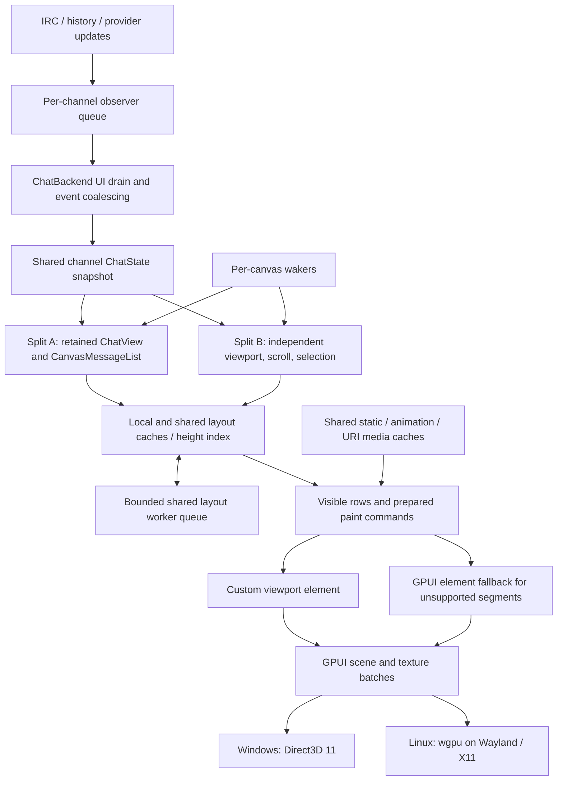

# Architecture

Echo is a Rust desktop chat client for Twitch built on Zed's GPUI framework
(through a small, reproducible fork; see [GPUI_FORK.md](GPUI_FORK.md)). This
page is the orientation map for contributors: where things live, how data
moves, and the invariants the renderer depends on.

## Data flow

Data flows **backend (Tokio, off the UI thread) -> bridge -> GPUI state
entities -> canvas renderer**.

## Source map

- `src/backend/`: everything that talks to Twitch and the emote providers,
  off the UI thread.
  - `irc/`: the Twitch IRC connection, built on `twitch-irc`.
    `connection.rs` is the read-connection supervisor (watchdog, reconnect
    backoff) and `connection/` holds one file per concern: PRIVMSG ingestion,
    USERNOTICE, whispers, moderation lines, sending, anonymous mode,
    history loading, emote loading, retokenizing, self state, system rows,
    chatters, activity and blocked-user visibility. `format.rs` holds the
    text helpers shared by ingestion, history and chat replay;
    `join_scheduler.rs` paces JOINs process-wide; `room_state.rs` and
    `user_colors.rs` keep per-channel and per-user state.
  - `twitch_api.rs` (Helix) with typed failures in `api_error.rs`;
    `eventsub.rs` (the EventSub WebSocket client) with payload decoding and
    the surfacing policy in `eventsub/notification.rs`.
  - `emotes/`: the providers (`twitch.rs`, `bttv.rs`, `ffz.rs`, and 7TV REST
    in `seventv.rs`), the 7TV EventAPI (`seventv_eventapi.rs`), personal
    emotes (`personal.rs`), refresh scheduling (`refresh.rs`), the disk
    codec (`cache_codec.rs`), the per-channel lookup-map publication
    (`publication.rs`) and the lock-free lookups chat ingestion reads
    (`lookup.rs`).
  - History: `history.rs` (the recent-messages API) and the per-channel disk
    store in `history_cache.rs`, with readable per-day text logs in
    `history_cache/readable_logs.rs` and decoders for older formats in
    `history_cache/legacy.rs`.
  - Badges, cosmetics (name paints, personal emotes), commands, filters,
    highlights, moderation, notifications, sounds, uploads, updates, and
    settings (`settings.rs`, with secret storage in `settings/secrets.rs`).
  - Some one-line modules (for example `models.rs`, `deduplicator.rs`,
    `link_types.rs`, `cosmetics_core.rs`) only re-export an extracted crate
    (see Workspace members), so the `crate::backend::...` paths resolve.
  - Functions that publish chat, history or whisper rows take a
    `&blocked_users::VisibilityCommit`, so they can only run while the
    visibility commit gate is held; `lock_utils.rs` documents the lock order.
- `src/backend/bridge/`: the UI's entry point for backend work (initialization
  and shutdown, chat, emotes, auth, moderation, events and metrics, and
  settings wrappers). Backend operations that run on the backend runtime go
  through it. UI code also imports backend types and calls cheap read-only
  lookups (cached room state, emote and user lookups, metrics counters)
  directly. Settings are the documented exception for writes: the settings UI,
  and components that persist a preference, read and write
  `crate::backend::settings` directly rather than through the bridge's
  settings wrappers.
- `src/backend/slots/`: message tokenization into render units and emote
  resolution. Resolver versions are bumped deliberately; don't cascade emote
  version bumps automatically.
- `src/state/`: GPUI `Entity` state: `AppState`, per-channel
  `ChatBackend`/`ChatState`, the bounded `MessageBuffer` with its
  version-keyed cached snapshot, retention, and layout eviction. Cross-thread
  change detection uses **version polling** (atomic counters in
  `echo_core::version_registry`), not push notifications. `state::install_domain_ports`
  binds the extracted crates' ports at startup.
- `src/components/chat/canvas_renderer/`: the hot path. Each chat view is one
  custom canvas, not an element per token. `text_shaping.rs` (with
  `text_shaping/` for badges, emotes, embeds, day dividers, the layout
  builder and tracing) produces shaped layouts, cached per split and in the
  shared `global_layout_cache.rs`; `async_layout.rs` runs layout off the UI
  thread; `painter.rs` and `painter/` paint visible rows only (including the
  wakers in `painter/wake.rs` and async-layout completion in
  `painter/async_layouts.rs`); `seventv_paint.rs` composites 7TV name paints
  using the fork's glyph-mask API; `bounded_map.rs` holds bounded memo tables
  for cheap-to-recompute values. The layout model, hit testing, multi-message
  selection, line buffering, font metrics, text-run interning, paint-layer
  order and the 7TV paint recipe live in `crates/echo-chat-render`, and the
  Fenwick height tree (O(log n) scroll lookups), bidi analysis and the
  eviction cache in `crates/echo-render-core`; renderer code imports those
  crates directly. The root `layout.rs` keeps only the theme- and
  settings-dependent part.
- `src/components/`: the rest of the UI, by feature area.
  - `chat/`: chat panes, headers, the composer and the channel popout.
  - `overlays/`: in-window overlays and the popouts that host them. The emote
    picker is `overlays/emote_picker/`: one grid core (`core.rs`, `grid.rs`,
    `rows.rs`, `signals.rs`, prefetch and stability tracking) shared by the
    inline (`inline.rs`) and popout (`popout.rs`) hosts. The user card is
    `overlays/user_card/` (`view.rs`, `note.rs`, `recent_messages.rs`,
    `mod_actions.rs`, `badges.rs`), opened in its own window by
    `user_card_popout.rs`. `overlays/image_ready.rs` is the "an image became
    ready" repaint signal: one generation counter, with a last-seen
    generation per consumer, so every consumer sees every signal.
  - `settings/`: the settings surface, its navigation tree, pages
    (`sections/`) and widget primitives (see Settings UI conventions).
  - `tabs/`: the tab bar (`tab_bar_renderer.rs`, with tab items and menus in
    `tab_bar_renderer/`) and its benchmark-fixture adapter
    (`benchmark_hooks.rs`).
  - `streamer_overlay/`: the borderless streamer overlay window.
  - `ui/`: shared building blocks written directly on GPUI: the window root,
    buttons, menus, the single-line text input (`ui/input/`, including the
    mixed-direction geometry probe in `bidi_probe.rs` used by the feedback
    benchmark), accessibility helpers, the native-window root and
    `singleton_window.rs` (see Native windows).
  - `common/`: helpers shared by several areas, such as moderation buttons
    and policy and the capped unread-count label (`count_label.rs`).
  - `auth/`, `sidebars/`, `splits/`, `top_bar/`, `debug_popup.rs` and
    `logo.rs`.
- `src/cache/`: the image and emote pipeline owned by `ImageCacheService`
  (`service.rs`). `loader.rs` (loading and off-thread decode), `uri_layer.rs`,
  `native_sizes.rs` and `animation_source.rs` are implemented here; the
  memory, disk and frame layers and the warming tracker come from
  `crates/echo-media-cache`, and the budgets, stats and preload plans from
  `crates/echo-cache-policy`, re-exported under the `crate::cache::*` paths.
- `src/managers/`: app-shell coordination that is not itself a view: the
  frame-rate controller, dynamic tick scheduler, the polling coordinator
  (its `PollLoop` and `Cadence`, with queued `UiAction` routing in
  `polling_coordinator/ui_action_dispatch.rs`), the composer input manager
  (one draft per split), render hooks, and the tab, split-layout and overlay
  managers. Rendering is event driven with mode-aware frame caps (focused,
  idle, unfocused); don't add constant repaint loops.
- `src/app.rs` and `src/app/`: the top-level `EchoApp` view, with the split
  menu (`split_menu.rs`), the activity rail (`activity_rail.rs`), the
  pending-UI-work pass that drains backend queues needing `EchoApp`-owned
  entities (`pending_ui_work.rs`), the settings importer's app side and the
  benchmark drivers. `src/event_handlers.rs` wires hotkeys and actions; every
  hotkey is a `HotkeyAction`.
- `src/main.rs` installs the panic hook, the single-instance lock and the
  global allocator: the system heap on Windows (GPUI's application manifest
  opts into the segment heap) unless the `windows-mimalloc` feature is
  enabled, mimalloc on Linux, and the `dhat-heap`/`alloc-profile` features
  swap in profiling allocators.
- `src/storage_roots.rs`: every Echo-owned config, data, cache, log and
  runtime path (see Guard scripts).
- `src/diagnostics/`: opt-in measurement: allocation and heap profiling,
  tracing and log-file setup (`profiling.rs`), the FPS profiler, startup
  markers and `--demo` mode. Each is inert unless its environment switch,
  cargo feature or command-line flag enables it.
- `src/bench/`: benchmark hooks that ship in every build because the perf
  rigs measure the distributed binary: the isolated-profile receipt, the
  live-channel workload, the UI fixture and the no-send guard.
- `src/log.rs` (log categories and redaction), `src/theme/` (colors, design
  tokens, fonts), `src/utils/` (clipboard, URL opening, window helpers such
  as always-on-top, atomic files), and the platform activation and tray
  modules.

## Cross-file flows

- **Message ingress.** IRC processing (tokenize, filters, highlights) runs on
  one Tokio task, stores the row in the backend buffer, then emits
  `ChannelEvent`s. `src/state/chat_observer.rs` queues them per channel
  (bounded at 4,096 events; overflow forces a snapshot refresh). The polling
  coordinator drains every dirty channel on the UI thread through
  `ChatBackend::process_observer_events`, which coalesces `NewMessage`s into
  `ChatState`'s shared snapshot (`crates/echo-core/src/chat_snapshot.rs`).
  Each split's `ChatView` then syncs its `CanvasMessageList`.
- **Duplicate-channel splits** share one `ChatState`. Each split owns its own
  `CanvasMessageList` (scroll, selection, width-dependent layout) keyed by a
  stable `SplitId`. Split-specific actions carry the source `SplitId`
  (`find_open_split_target` in `src/app.rs`); channel-only actions resolve to
  the tab's active split.
- **Wake loops are per canvas** (`canvas_renderer/painter/wake.rs`): an
  animation waker that sleeps until that split's next visible frame change
  and skips the notify when the visible-frame signature is unchanged, an
  async-layout waker, an image-load waker keyed on a visible-image readiness
  signature, and a width-stabilization waker that renders once more after a
  pending width-bucket change settles. A canvas repaints only when one of
  these, input, or a model change notifies it.
- **Animation patching.** An animation tick patches the new emote or
  name-paint frame into the already presented scene
  (`Window::patch_animated_image` in the fork) instead of redrawing the
  window; a full repaint happens only when visible animated content has no
  patchable slot. `ECHO_ANIMATION_PATCH=0` turns patching off.
- **Async layout** (`canvas_renderer/async_layout.rs`) is one process-wide
  bounded queue (1,024 jobs, 2-6 workers) shared by all splits, fenced by a
  per-split generation/epoch so stale jobs are discarded rather than
  published.
- **Rows paint on the direct canvas** unless their `ElementRenderPlan`
  (`painter/element_render.rs`) needs a GPUI element fallback (animations
  still loading, SVG, inline boxes, replies, embeds, uploads, deleted rows).
  The render aggregate log reports the fallback reasons.
- **Overlay image readiness.** The image loader calls
  `components::overlays::notify_image_loaded` and
  `notify_animation_refilled`, which bump one generation counter
  (`overlays/image_ready.rs`). The app and the two emote-picker hosts each
  call `take_image_ready` with their own `ImageReadyConsumer`, so each of
  them repaints once per new generation regardless of polling order.
- **Split dividers.** Dragging a divider adjusts the split ratios through
  `TabState::adjust_ratio` (`crates/echo-core/src/tab_state.rs`), which
  respects each pane's minimum size and leaves a locked tab unchanged.

## Native windows

Every Echo-owned native window opens through
`components::ui::open_native_window` (`src/components/ui/native_window_root.rs`),
which wraps the view in `NativeWindowRoot`: it installs the bounded, shared
URI image cache at the window's outermost element and reports the window's
activation. `scripts/check-native-window-roots.ps1` keeps an explicit list of the files
allowed to call it. Popouts that exist at most once (the emote picker, user
card, media inspector, debug and streamer-overlay windows) keep their open
flag, window handle and pending-open state in a static
`components::ui::SingletonWindow` (`src/components/ui/singleton_window.rs`).
When the stored handle has gone stale, the popout runs its close bookkeeping
and opens a new window.

## Design boundaries

1. **Channel state owns messages once.** Duplicate views of a channel don't
   parse, fetch or store it again; each keeps its own scroll, selection,
   focus and width-dependent layout. Immutable layouts are shared across
   views only when their full cache identity agrees.
2. **A split owns presentation demand.** A stable `SplitId` survives moves
   and resizes. Visibility, width, scale, visible media and the next due
   deadline belong to the split.
3. **Scheduling follows demand.** Hidden canvases unregister their wakers;
   foreground, unfocused-visible, hidden and minimized windows keep distinct
   policies.
4. **Static layout and dynamic playback stay separate.** Shaped text, source
   ranges, row geometry and hitboxes survive animation-only changes; dynamic
   frames, name paints, selection and hover keep their paint order.
5. **Memory is admitted and retired by owner.** Source bytes, decoded frames,
   `RenderImage`s, layout bytes, URI media and atlas allocations are
   accounted separately (`crates/echo-cache-policy/src/budget.rs`,
   `src/cache/loader.rs`).
6. **The application shell reacts to shell changes.** Geometry, tabs,
   metadata, overlays and input rebuild their own state; chat and animation
   activity avoid unnecessary ancestor work.

When a trace points at a GPUI or driver bottleneck, reproduce it with
`tools/gpui-scene-bench` in a real native window before changing the fork.

## Renderer invariants

- **Async layout lifecycle.** A rejected job (queue full) restores the prior
  status and falls back to synchronous layout for visible rows. An older
  layout identity or generation never publishes over, or removes, a newer
  in-flight entry. Closing a split cancels its queued work without
  publishing orphaned results and releases every admitted-job count.
- **Logical text order.** Mixed right-to-left and left-to-right content keeps
  its logical `source_text`; copy and selection follow logical order, and
  shaping owns visual order (`text_shaping.rs`).
- **Remembered media sizes.** `src/cache/native_sizes.rs` keeps up to 16,384
  decoded image sizes by URL hash (persisted, no expiry) so first layouts
  after a restart match the decoded media. A decode whose size differs from
  the remembered one must relay out every resident row that used the old
  size, in every split.

## Manual renderer checks

Some behavior can only be confirmed in a running native window. After
renderer changes, check the relevant items:

- kerning-heavy text, mixed emoji and text, and emote-heavy lines with emote
  spacing on and off;
- mixed-direction copy and drag selection; double-click word and
  triple-click message selection next to emotes and emoji;
- long URL, CJK and emoji-cluster wrapping at several widths, and width
  changes during a rapid resize;
- selection and hitboxes after scrolling, and the selection/viewport anchor
  at the history cap and after a burst of moderation deletions while scrolled
  up;
- mention, selection, text and image paint-layer order;
- no username shift when the badge set arrives on a cold start;
- two monitors with different DPI: each window uses its own scale, and
  moving between monitors relays out once;
- moderation-mode buttons in a narrow split wrap, with continuation lines
  indented past them;
- message deletions and chat clears with the same channel open in two
  splits, one of them hidden.

## Settings UI conventions

- Settings has seven pages (General, Appearance, Chat, Highlights &
  notifications, Moderation & filters, Links & media, Shortcuts & commands)
  plus a separate Advanced page. Only live diagnostics require developer
  mode.
- Each page leads with a short primary group. Secondary preferences sit in at
  most one disclosure per group, as its last row. Expanded sections use small
  headings rather than nested disclosures; collections show summary rows and
  open their editors for Add/Edit.
- Search targets stable per-control IDs and opens the disclosures it needs.
  Revealing a setting through search never enables a feature or developer
  mode, and clearing the search restores the previous state.
- Navigation is a two-level tree of pages and scroll anchors, defined once in
  `src/components/settings/settings_navigation.rs`. The sidebar order is
  `PAGE_ORDER`. Retired pages and anchors survive only as the `LEGACY_*`
  alias tables (`LEGACY_SLUGS` and the `LEGACY_*_SUBSECTIONS` lists), which
  share their search keywords with the current pages through named
  `*_KEYWORDS` constants.
- Keep `settings.json` keys and format stable, and keep legacy page/anchor
  aliases working when navigation changes. `AppSettings::default()` is the
  one source of `settings.json` defaults: `AppSettings` is a
  `#[serde(default)]` container, and its only field-level defaults are
  migration markers that let a load tell a missing field from a default one.
- The settings UI reads and writes `crate::backend::settings` directly; it is
  the documented exception to reaching the backend through
  `src/backend/bridge/`.
- Build pages from the primitives in `src/components/settings/widgets.rs`
  (`setting_row`, `setting_toggle_row`, `setting_compact_row`,
  `labelled_toggle`, `settings_disclosure`, `settings_summary_disclosure`,
  `settings_select`, `settings_menu_button`, `settings_group`). Disclosure
  state lives in `SettingsSurface::disclosure_state`
  (`src/components/settings/settings_surface.rs`); it lasts for the open
  settings session and is never saved.
- A section editor that keeps per-host state registers its cleanup in
  `sections::release_host_editor_state` and `release_hidden_page_inputs`
  (`src/components/settings/sections/mod.rs`): the first runs when a settings
  surface closes, the second releases the inputs of pages that are no longer
  on screen.

## Guard scripts

This is the complete list of repository guards. Run the relevant one after
touching the area it guards; those with a self-test take `-SelfTest`
(`--self-test` for shell scripts).

- `scripts/check-native-window-roots.ps1` (self-test): every Echo native window
  must open through `components::ui::open_native_window`, which installs the
  shared, bounded URI image cache at the window root. Update the script's
  caller list when adding a window.
- `scripts/check-storage-roots.ps1` and `.sh` (self-test): every
  config, data and cache path must go through `src/storage_roots.rs`, so
  that `ECHO_BENCH_PROFILE_ROOT` can isolate all of Echo's state. OS-external
  discovery (for example OBS and Discord logs) stays outside the profile and
  is skipped while it is active. The Linux suite runs the shell version.
- `scripts/check-linux-test-inventory.sh`: the reviewed test, contract-tool and
  doctest baseline in `scripts/linux-test-inventory.tsv`, plus the
  `gpui::test` shadowing guard ([LINUX_DEVELOPMENT.md](LINUX_DEVELOPMENT.md)).
  Run by every Linux test mode.
- `scripts/check-ui-literals.ps1` (self-test): a ratchet on literal colors,
  spacing, radii and text sizes in `src/components`; counts may only fall
  below `scripts/ui-literals-baseline.txt`. Use `theme::colors` and
  `theme::tokens` instead, and rerun with `-UpdateBaseline` after removing
  literals.
- `scripts/check-gpui-cursor-state.ps1`: compiles the GPUI fork's Windows cursor
  handlers against stubbed Win32 boundaries
  ([GPUI_FORK.md](GPUI_FORK.md), cursor ownership). Run it after changing that
  patch.

## Workspace members

- `crates/echo-*`: extracted crates. Most are GPUI-free domain and policy
  crates: `echo-core` (messages, the message buffer and chat snapshot,
  deduplication, channel observers and lifecycle, tab and workspace layout
  state, filter expressions, hotkeys, OAuth token sanitizing, custom-command
  triggers, notification truncation, the slot resolver, and the `ECHO_*`
  switch parsing in `echo_core::env`), `echo-text-core`,
  `echo-emote-core`, `echo-cosmetics-core`, `echo-link-core` (link types and
  the image-uploader policy), `echo-autocomplete-core`, `echo-cache-policy`
  (budgets, stats, preload plans, the loaded-URL dedup registry) and
  `echo-render-core` (height tree, bidi, animation timing). Two depend on
  GPUI: `echo-media-cache` (decoded-image, animation-frame and disk layers,
  the deferred sprite-atlas release queue, the picker's visible-media sets)
  and `echo-chat-render` (layout model, hit testing, selection, paint-layer
  order, width bucketing, RTL hit mapping, line buffering, font metrics, the
  7TV name-paint recipe, text-run interning). Unit tests concentrate here.
  Small root modules under `src/backend/` and `src/cache/` re-export some of
  these crates under their `crate::backend::...` and `crate::cache::...`
  paths; renderer code imports `echo-chat-render` and `echo-render-core`
  directly. `echo_core::badge_key` holds the badge-key helpers, and
  `HotkeyAction` implements `Display` and `FromStr`.
- **Ports.** Where extracted code needs a root lookup, the crate exposes an
  `install_*` fn-pointer port whose default is the standalone behaviour (an
  emote-map miss, the default emoji style, nothing persisted or retained, no
  prefetch), so a crate run standalone, as in tests and tools, degrades
  rather than guesses. `echo-core` lists its ports and their fallbacks in its
  `lib.rs` docs. `main.rs` binds them at startup: `log::init` and
  `state::install_domain_ports` (log categories, the watched channel, emote
  preferences, the animation clock, message-buffer ports), then
  `install_render_ports()` (`echo-chat-render`'s `ports.rs`). The slot
  resolver's ports are bound by `backend::bridge::init::initialize`,
  `echo_media_cache`'s by the loader's disk- and frame-layer initializers,
  the whispers-channel predicate by the channel lifecycle manager's first
  use, and the text-run font families by `theme::fonts`.
- `tools/*`: standalone binaries (`*-check`, `*-bench`) whose package name
  equals the directory name, so `cargo run -p <dir>` runs any of them. Each
  `main.rs` opens with a doc line naming its kind, and
  `scripts/linux-test-targets.tsv` classifies every binary as `contract`
  (deterministic, no arguments, asserts only, no timing), `fixture`,
  `runtime`, `benchmark` or `helper`. Checks print `fixture,<name>,pass` rows
  through the shared `tools/check-support` library. Many tools compile real
  Echo source through `#[path = "../../../src/..."]` next to hand-written
  stubs of the surrounding modules, so changing a signature in `src/` can
  break a tool's stubs. Tools compile in the workspace gates; the Linux test
  script runs the contract tools. `tools/echo-update-core` is the Windows
  update installation and rollback library shared by Echo and the
  `echo-version` helper.
- Shared dependency versions, including the pinned Zed revision of `gpui`,
  `gpui_platform` and `reqwest_client`, live in the root `Cargo.toml`'s
  `[workspace.dependencies]`; members inherit them with
  `<name>.workspace = true`.
- `benches/`: Criterion benchmarks (Rust code, part of the root package).
- `benchmarks/`: data for the benchmark scripts, not code: replay and render
  fixtures under `benchmarks/fixtures/` and the default, uncommitted run output
  under `benchmarks/results/` ([BENCHMARKING.md](BENCHMARKING.md)).
- `scripts/`: the Linux test harness, the guards above, GPUI fork setup, and the
  benchmark scripts under `scripts/bench/`.
