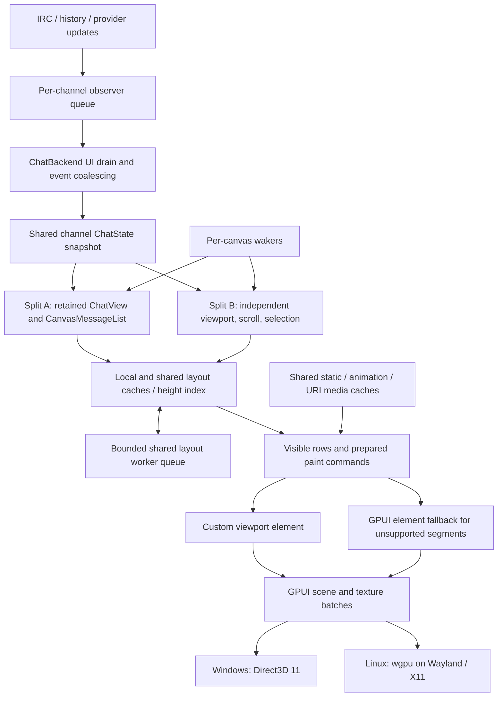

# Architecture

Echo is a Rust desktop chat client for Twitch built on Zed's GPUI framework
(through a small, reproducible fork; see [GPUI_FORK.md](GPUI_FORK.md)). This
page is the orientation map for contributors: where things live, how data
moves, and the invariants the renderer depends on.

## Data flow

Data flows **backend (Tokio, off the UI thread) -> bridge -> GPUI state
entities -> canvas renderer**.

## Source map

- `src/backend/`: Twitch IRC (`irc/`, built on `twitch-irc`), Helix
  (`twitch_api.rs`), EventSub (`eventsub.rs`), the 7TV EventAPI
  (`emotes/seventv_eventapi.rs`), BTTV/FFZ/7TV emote providers, badges,
  cosmetics (name paints, personal emotes), commands, filters, highlights,
  moderation, settings, and history (`history.rs` API plus the per-channel
  disk store in `history_cache.rs`).
- `src/backend/bridge/`: the only API the UI should call into the backend
  (chat, emotes, auth, settings, moderation, events).
- `src/backend/slots/`: message tokenization into render units and emote
  resolution. Resolver versions are bumped deliberately; don't cascade emote
  version bumps automatically.
- `src/state/`: GPUI `Entity` state: `AppState`, per-channel
  `ChatBackend`/`ChatState`, the bounded `MessageBuffer` with its
  version-keyed cached snapshot, retention, and layout eviction. Cross-thread
  change detection uses **version polling** (atomic counters in
  `version_manager.rs`), not push notifications.
- `src/components/chat/canvas_renderer/`: the hot path. Each chat view is one
  custom canvas, not an element per token. `layout.rs` and `text_shaping.rs`
  produce shaped layouts, cached per split and in the shared
  `global_layout_cache.rs`; `height_tree.rs` (a Fenwick tree) gives O(log n)
  scroll lookups; `painter*.rs` paints visible rows only;
  `hit_testing.rs`/`selection.rs` implement multi-message selection;
  `seventv_paint.rs` composites 7TV name paints using the fork's glyph-mask
  API; `bidi.rs` handles right-to-left text.
- `src/cache/`: the image and emote pipeline owned by `ImageCacheService`
  (memory, disk, frame and URI layers, budgets, warming, preload plans).
  Decoding runs off the UI thread. Runtime pieces are shared with
  `crates/echo-media-cache`.
- `src/managers/`: frame-rate controller, dynamic tick scheduler, polling
  coordinator, and tab/split/overlay/input managers. Rendering is event
  driven with mode-aware frame caps (focused, idle, unfocused); don't add
  constant repaint loops.
- `src/app.rs`: the top-level `EchoApp` view. `src/event_handlers.rs` wires
  hotkeys and actions. `src/main.rs` installs the panic hook, the
  single-instance lock and the global allocator: the system heap on Windows
  (GPUI's application manifest opts into the segment heap) unless the
  `windows-mimalloc` feature is enabled, mimalloc on Linux, and the
  `dhat-heap`/`alloc-profile` features swap in profiling allocators.

## Cross-file flows

- **Message ingress.** IRC processing (tokenize, filters, highlights) runs on
  one Tokio task, stores the row in the backend buffer, then emits
  `ChannelEvent`s. `src/state/chat_observer.rs` queues them per channel
  (bounded at 4,096 events; overflow forces a snapshot refresh). The polling
  coordinator drains every dirty channel on the UI thread through
  `ChatBackend::process_observer_events`, which coalesces `NewMessage`s into
  `ChatState`'s shared snapshot (`crates/echo-core/src/chat_snapshot.rs`).
  Each split's `ChatView` then syncs its `CanvasMessageList`.
- **Duplicate-channel splits** share one `ChatState`. Each split owns its own
  `CanvasMessageList` (scroll, selection, width-dependent layout) keyed by a
  stable `SplitId`. Split-specific actions carry the source `SplitId`
  (`find_open_split_target` in `src/app.rs`); channel-only actions resolve to
  the tab's active split.
- **Wake loops are per canvas** (`canvas_renderer/painter/wake.rs`): an
  animation waker that sleeps until that split's next visible frame change
  and skips the notify when the visible-frame signature is unchanged, an
  async-layout waker, and an image-load waker keyed on a visible-image
  readiness signature. A canvas repaints only when one of these, input, or a
  model change notifies it.
- **Animation patching.** An animation tick patches the new emote or
  name-paint frame into the already presented scene
  (`Window::patch_animated_image` in the fork) instead of redrawing the
  window; a full repaint happens only when visible animated content has no
  patchable slot. `ECHO_ANIMATION_PATCH=0` turns patching off.
- **Async layout** (`canvas_renderer/async_layout.rs`) is one process-wide
  bounded queue (1,024 jobs, 2-6 workers) shared by all splits, fenced by a
  per-split generation/epoch so stale jobs are discarded rather than
  published.
- **Rows paint on the direct canvas** unless their `ElementRenderPlan`
  (`painter/element_render.rs`) needs a GPUI element fallback (animations
  still loading, SVG, inline boxes, replies, embeds, uploads, deleted rows).
  The render aggregate log reports the fallback reasons.

## Design boundaries

1. **Channel state owns messages once.** Duplicate views of a channel don't
   parse, fetch or store it again; each keeps its own scroll, selection,
   focus and width-dependent layout. Immutable layouts are shared across
   views only when their full cache identity agrees.
2. **A split owns presentation demand.** A stable `SplitId` survives moves
   and resizes. Visibility, width, scale, visible media and the next due
   deadline belong to the split.
3. **Scheduling follows demand.** Hidden canvases unregister their wakers;
   foreground, unfocused-visible, hidden and minimized windows keep distinct
   policies.
4. **Static layout and dynamic playback stay separate.** Shaped text, source
   ranges, row geometry and hitboxes survive animation-only changes; dynamic
   frames, name paints, selection and hover keep their paint order.
5. **Memory is admitted and retired by owner.** Source bytes, decoded frames,
   `RenderImage`s, layout bytes, URI media and atlas allocations are
   accounted separately (`crates/echo-cache-policy/src/budget.rs`,
   `src/cache/loader.rs`).
6. **The application shell reacts to shell changes.** Geometry, tabs,
   metadata, overlays and input rebuild their own state; chat and animation
   activity avoid unnecessary ancestor work.

When a trace points at a GPUI or driver bottleneck, reproduce it with
`tools/gpui-scene-bench` in a real native window before changing the fork.

## Renderer invariants

- **Async layout lifecycle.** A rejected job (queue full) restores the prior
  status and falls back to synchronous layout for visible rows. An older
  layout identity or generation never publishes over, or removes, a newer
  in-flight entry. Closing a split cancels its queued work without
  publishing orphaned results and releases every admitted-job count.
- **Logical text order.** Mixed right-to-left and left-to-right content keeps
  its logical `source_text`; copy and selection follow logical order, and
  shaping owns visual order (`text_shaping.rs`).
- **Remembered media sizes.** `src/cache/native_sizes.rs` keeps up to 16,384
  decoded image sizes by URL hash (persisted, no expiry) so first layouts
  after a restart match the decoded media. A decode whose size differs from
  the remembered one must relay out every resident row that used the old
  size, in every split.

## Manual renderer checks

Some behavior can only be confirmed in a running native window. After
renderer changes, check the relevant items:

- kerning-heavy text, mixed emoji and text, and emote-heavy lines with emote
  spacing on and off;
- mixed-direction copy and drag selection; double-click word and
  triple-click message selection next to emotes and emoji;
- long URL, CJK and emoji-cluster wrapping at several widths, and width
  changes during a rapid resize;
- selection and hitboxes after scrolling, and the selection/viewport anchor
  at the history cap and after a burst of moderation deletions while scrolled
  up;
- mention, selection, text and image paint-layer order;
- no username shift when the badge set arrives on a cold start;
- two monitors with different DPI: each window uses its own scale, and
  moving between monitors relays out once;
- moderation-mode buttons in a narrow split wrap, with continuation lines
  indented past them;
- message deletions and chat clears with the same channel open in two
  splits, one of them hidden.

## Settings UI conventions

- Settings has seven pages (General, Appearance, Chat, Highlights &
  notifications, Moderation & filters, Links & media, Shortcuts & commands)
  plus a separate Advanced page. Only live diagnostics require developer
  mode.
- Each page leads with a short primary group. Secondary preferences sit in at
  most one disclosure per group, as its last row. Expanded sections use small
  headings rather than nested disclosures; collections show summary rows and
  open their editors for Add/Edit.
- Search targets stable per-control IDs and opens the disclosures it needs.
  Revealing a setting through search never enables a feature or developer
  mode, and clearing the search restores the previous state.
- Keep `settings.json` keys and format stable, and keep legacy page/anchor
  aliases working when navigation changes.
- Build pages from the primitives in `src/components/settings/widgets.rs`
  (`setting_row`, `settings_disclosure`, `settings_summary_disclosure`,
  `settings_select`, `settings_menu_button`, `settings_group`). Disclosure
  state lives in `SettingsSurface::disclosure_state`
  (`src/components/settings/settings_surface.rs`); it lasts for the open
  settings session and is never saved.

## Guard scripts

- `scripts/check-native-window-roots.ps1`: every Echo native window must open
  through `components::ui::open_native_window`, which installs the shared,
  bounded URI image cache at the window root. Update the script's caller list
  when adding a window.
- `scripts/check-benchmark-profile-roots.ps1` (and `.sh`): every config, data
  and cache path must go through `src/benchmark_profile.rs`, so that
  `ECHO_BENCH_PROFILE_ROOT` can isolate all of Echo's state. OS-external
  discovery (for example OBS and Discord logs) stays outside the profile and
  is skipped while it is active.

Run them with `-SelfTest` (`--self-test` for the shell script) after touching
the area they guard.

## Workspace members

- `crates/echo-*`: extracted crates. Most are GPUI-free domain and policy
  crates (core, text, emote, cosmetics, link, autocomplete, cache-policy,
  render-core); `echo-media-cache` and `echo-chat-render` depend on GPUI.
  Unit tests concentrate here.
- `tools/*`: standalone contract and fixture binaries (`*-check`) and
  benchmarks (`*-bench`). Many compile real Echo source through
  `#[path = "../../../src/..."]` next to hand-written stubs of the
  surrounding modules, so changing a signature in `src/` can break a tool's
  stubs. Tools compile in the workspace gates and run in the Linux test
  script.
- `benches/`: Criterion benchmarks.
